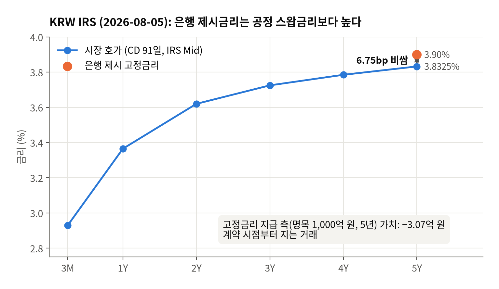
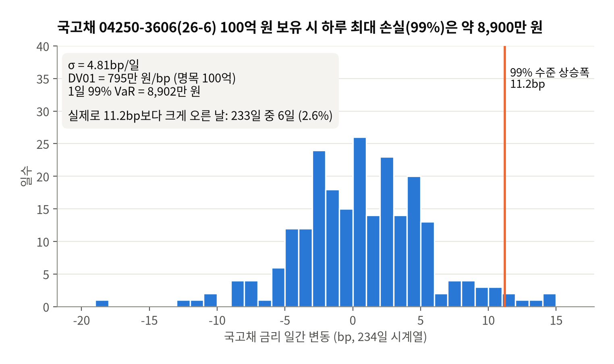
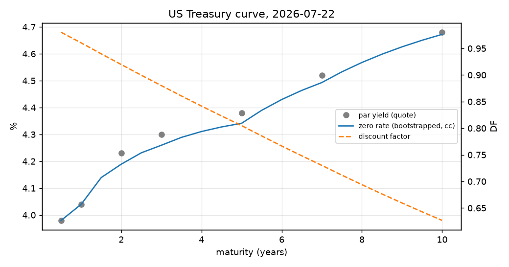

# rates-pricing-toolkit

> **English summary.** Three rates problems I first solved in Excel, ported to Python and checked against my Excel answers to six decimal places. (1) A bank quotes a 5Y KRW pay-fixed IRS at 3.90% when the fair swap rate from the CD and IRS curve is 3.8325%: the 6.75bp gap makes the swap worth about −KRW 307m to the fixed payer on KRW 100bn notional from day one. (2) A KRW 10bn position in KTB 26-6 has a DV01 of about KRW 7.95m per bp and a 1-day 99% delta-normal VaR of about KRW 89m; in the actual 233 daily moves, the 99% threshold was breached 6 times (2.6%), so the normal assumption understates the tail. (3) A UST zero curve bootstrapped from par yields. The Excel comparison also showed that Solver had stopped at a 5Y swap rate of 3.8324965% instead of the 3.8325% quote.

KRW IRS 제시금리 평가, 국고채 포지션의 금리 리스크, 미 국채 zero curve를 U.FE.A 금융공학학회 실습과제로 Excel에서 풀고, Python으로 옮겨 결과를 대조했습니다.



## 1. KRW IRS: 은행이 제시한 금리는 공정한가

**상황.** 2026-08-05, A사가 은행과 5년 KRW IRS를 맺습니다. A사는 고정금리 3.90%를 내고 CD 91일 금리를 받습니다. 명목금액 1,000억 원, 분기 지급입니다.

**한 일.** CD 91일과 서울외국환중개 IRS 1~5년 Mid 호가로 할인 커브를 부트스트랩하고, 그 커브에서 고정 레그와 변동 레그의 현재가치를 계산했습니다.

**결과.** 5년 공정 스왑금리는 시장 호가와 같은 3.8325%입니다. 은행 제시금리는 이보다 6.75bp 높습니다.

| 항목 | 값 |
|---|---:|
| 고정 레그 PV (A사가 낼 돈) | 177.17억 원 |
| 변동 레그 PV (A사가 받을 돈) | 174.11억 원 |
| A사 입장의 스왑 가치 | **−3.07억 원** |

A사는 계약하는 순간 약 3억 원을 잃는 거래입니다. 은행 입장에서는 이 6.75bp가 헤지 비용과 신용위험, 마진을 덮는 스프레드입니다.

## 2. 국고채 100억 원을 들고 있으면 하루에 얼마까지 잃을 수 있나

**상황.** 2026-07-30 결제로 국고채권 04250-3606(26-6, 2036년 만기, 표면금리 4.25%)을 수익률 4.311%에 100억 원 보유합니다.



| 항목 | 값 |
|---|---:|
| 가격 (액면 10,000원당, dirty) | 10,006.27원 |
| Macaulay / Modified Duration | 8.11 / 7.94 |
| Convexity | 75.34 |
| DV01 (명목 100억) | 7,947,728원 |
| 금리 일간 변동성 (최근 234일) | 4.81bp |
| 1일 99% VaR | 89,018,937원 |

금리가 1bp 오르면 약 795만 원을 잃습니다. Delta-Normal 방식으로는 하루 동안 99% 확률로 손실이 약 8,900만 원을 넘지 않습니다. 같은 기간 실제 일간 변동을 보면 233일 중 6일(2.6%)이 99% 기준인 11.2bp보다 크게 올랐습니다. 정규분포라면 1%, 약 2일이어야 합니다. 정규분포 가정이 큰 금리 상승의 빈도를 작게 잡는다는 뜻이라, 실제로 쓴다면 역사적 시뮬레이션 VaR나 스트레스 테스트를 함께 봐야 합니다.

## 3. 미 국채 zero curve



2026-07-22 미 재무부 par yield(6개월~10년)로 할인계수와 연속복리 zero rate를 부트스트랩했습니다. 10년 zero rate는 4.672346%입니다. 그림에서 zero rate가 par yield보다 낮게 보이는 것은 복리 기준이 달라서입니다. par yield는 반기 복리, zero rate는 연속복리입니다.

## Excel 답안과 대조

| 항목 | Python | Excel 답안 |
|---|---:|---:|
| UST zero 10Y | 4.672346% | 4.672346% |
| KRW 5Y 공정 스왑금리 | 3.8325000% | 3.8324965% |
| A사 IRS 가치 | −306,645,128원 | −306,660,906원 |
| 국고채 Modified Duration | 7.942749 | 7.942749 |
| DV01 (명목 100억) | 7,947,728원 | 7,947,728원 |
| 1일 99% VaR | 89,018,937원 | 89,018,937원 |

할인계수와 금리는 모든 지점에서 1e-6 안쪽으로 같고, 국고채와 VaR는 완전히 같습니다.

**IRS 가치가 1.6만 원 달랐던 이유.** Excel Solver가 5년 스왑금리를 호가 3.8325%가 아니라 3.8324965%에서 멈춰 있었습니다. 할인계수 차이는 7e-07에 불과하지만 명목 1,000억 원에 곱해지면 약 1.6만 원이 됩니다. Python은 모든 호가를 1e-12 안쪽으로 재현합니다.

**"최근 250영업일"이 234일이었던 이유.** 시작일을 Excel WORKDAY로 잡았는데, WORKDAY는 한국 공휴일을 빼지 않습니다. 실제 금리가 있는 날은 234일입니다.

## 한계

- UST 6개월·1년은 호가 수익률을 그대로 연속복리 zero rate로 쓴 과제 가정을 따랐습니다. 복리 기준을 맞추면 단기 구간이 조금 달라집니다.
- IRS는 단일 커브, 이자 기간 0.25년 고정, 영업일 조정 없음으로 단순화했습니다. 실제 원화 IRS 평가는 할인 커브와 예측 커브를 나누고 실제 이자 일수를 씁니다.
- 다음 단계로 KRD(Key Rate Duration)와 할인·예측 이중 커브를 붙일 수 있습니다.

<details>
<summary><b>구현 세부 (계산 방식, 코드 구조, 실행 방법, 검증)</b></summary>

### 계산 방식

Excel과 같은 가정을 그대로 옮겼습니다. 결과가 다르면 옮기는 과정의 실수인지 Excel 쪽 문제인지 가려내기 위해서입니다.

- **부트스트랩.** 시장 호가가 있는 만기의 할인계수를 par 조건으로 하나씩 풉니다. 그 사이 지급일은 ln DF 선형 보간입니다. 보간까지 포함한 par 조건을 `brentq`로 풉니다(Excel에서는 Solver).
- **UST.** 6M과 1Y는 호가 수익률을 그대로 연속복리 zero rate로 두고, 2Y~10Y는 반기 이표 par 채권 조건 (y/2)·ΣDF + DF(T) = 1로 풉니다.
- **KRW IRS.** 0.25년 DF는 CD 91일(단리), 1Y~5Y는 분기 지급 par swap 조건. 단일 커브, accrual 0.25 고정.
- **국고채.** 결제일 이후 이표일마다 t = 일수/365, DF = 1/(1 + y/2)^(2t)로 할인합니다.
- **VaR.** 금리 일간 변동(bp)의 표본 표준편차 × z(99%) × DV01 × √1일.

### 코드 구조

```
rates-pricing-toolkit/
├── src/ratestool/
│   ├── curve.py      par 부트스트랩(log-linear), zero rate
│   ├── ust.py        미 국채 zero curve
│   ├── irs.py        원화 IRS 커브, 3M 선도금리, pay-fixed 평가
│   ├── bond.py       이표 일정, 가격, 듀레이션, DV01, 컨벡시티
│   └── var.py        일간 변동성, Delta-Normal VaR
├── scripts/report.py     Python 결과와 Excel 답안을 나란히 출력, 그림 생성
├── tests/
│   ├── fixtures/inputs.json           과제 입력값
│   ├── fixtures/ktb_yields.csv        국고채 금리 시계열 (VaR 변동성)
│   └── fixtures/excel_expected.json   Excel 답안 결과값 (기준값)
└── figures/
```

계산은 NumPy 배열 연산이고, 금리 라이브러리(QuantLib 등)는 쓰지 않았습니다.

### 전체 대조표

`python scripts/report.py` 출력입니다.

| 항목 | Python | Excel 답안 | 차이 |
|---|---:|---:|---:|
| UST zero 2Y (%) | 4.189336 | 4.189337 | −5.3e-07 |
| UST zero 5Y (%) | 4.341417 | 4.341417 | 1.4e-07 |
| UST zero 10Y (%) | 4.672346 | 4.672346 | 2.1e-08 |
| KRW 5Y 공정 스왑금리 | 3.8325000% | 3.8324965% | 3.5e-08 |
| 고정 레그 PV (원) | 17,717,274,044 | 17,717,277,275 | −3,231 |
| 변동 레그 PV (원) | 17,410,628,916 | 17,410,616,369 | 12,547 |
| pay-fixed IRS 가치 (원) | −306,645,128 | −306,660,906 | 15,778 |
| 국고채 dirty price | 10006.269047 | 10006.269047 | 0 |
| Macaulay / Modified Duration | 8.113955 / 7.942749 | 8.113955 / 7.942749 | 0 |
| Convexity | 75.336051 | 75.336051 | 0 |
| DV01 (원, 명목 100억) | 7,947,728.23 | 7,947,728.23 | 0 |
| 1일 99% VaR (원) | 89,018,937 | 89,018,937 | 0 |

### 실행 방법

Python 3.10 이상.

```bash
pip install -e ".[dev]"
pytest
python scripts/report.py
```

그림까지 다시 그리려면 `pip install matplotlib`이 필요합니다.

### 개발 방식과 검증

과제 풀이와 Excel 답안은 직접 작성했습니다. Python 이식과 테스트, README는 Claude Code로 작성했습니다.

- Excel 파일에서 입력값과 결과값을 코드로 추출해 fixture로 두고, 셀 수식을 하나씩 확인하며 같은 가정으로 옮겼습니다.
- Excel과 다른 값이 나온 곳(IRS 금액)은 원인을 Solver 잔차로 확인한 뒤에 허용 오차를 정했습니다.
- Excel과 무관한 성질도 테스트합니다. 부트스트랩 커브가 모든 par 호가를 재현하는지, 공정 금리의 스왑 가치가 0인지, 단일 커브에서 변동 레그 PV가 1 − DF(T)와 같은지, 평평한 par 커브가 평평한 선도금리를 주는지입니다.

| 테스트 | 확인 내용 |
|---|---|
| `test_against_excel.py` | UST DF·zero rate, KRW IRS DF·선도금리·공정금리·레그 PV, 국고채 가격·듀레이션·컨벡시티·DV01, 금리 시계열의 일간 변동성, VaR가 Excel 답안과 일치 |
| `test_properties.py` | par 호가 재현, 공정 금리에서 가치 0, 변동 레그 = 1 − DF(T), 평평한 커브, 표본 표준편차 정의 |

</details>
